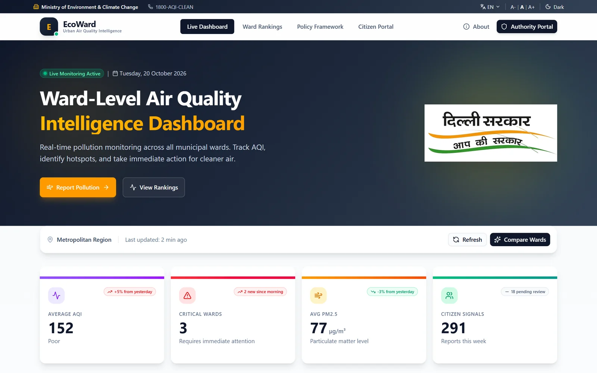
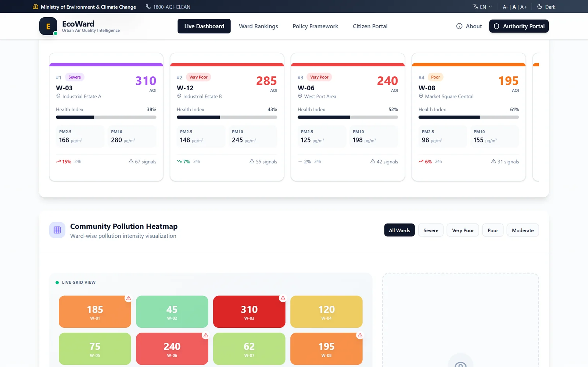
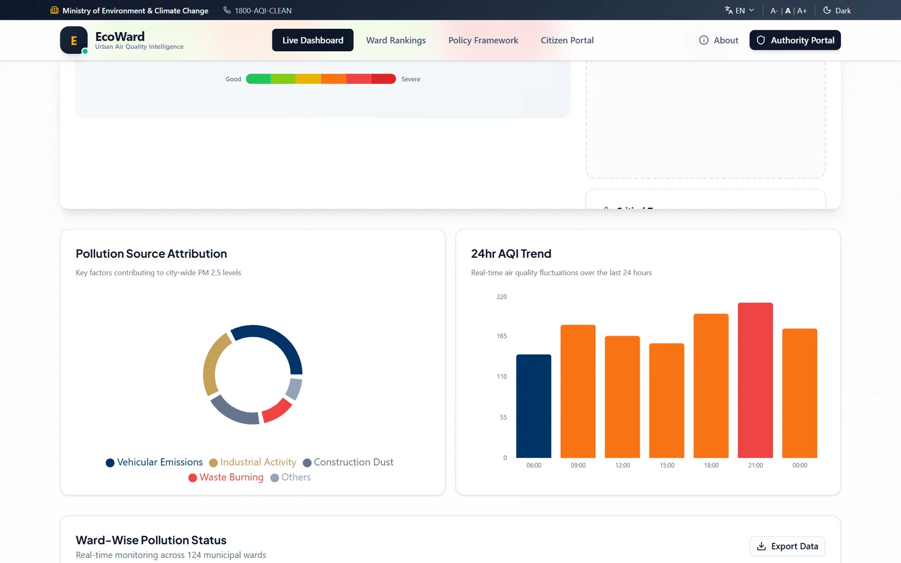
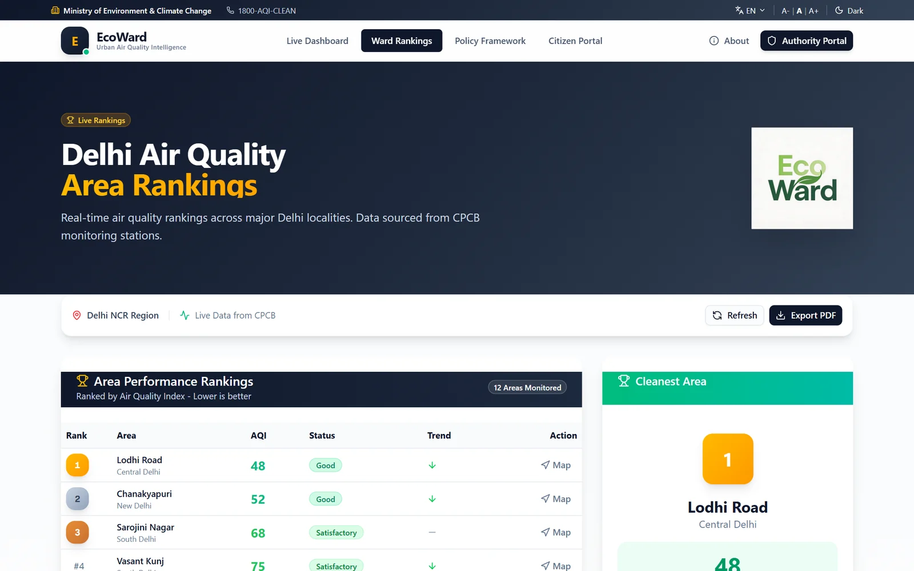
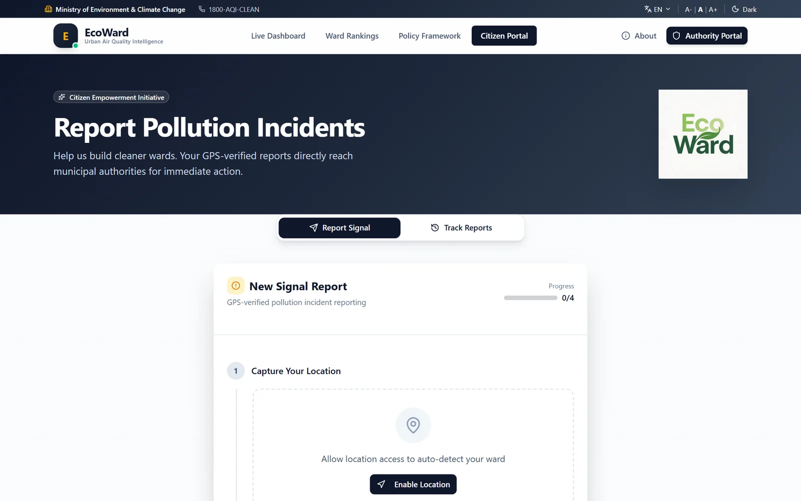
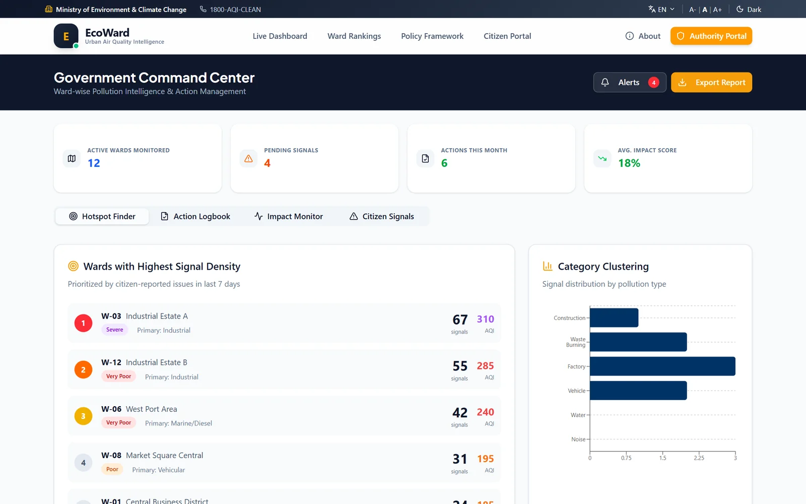
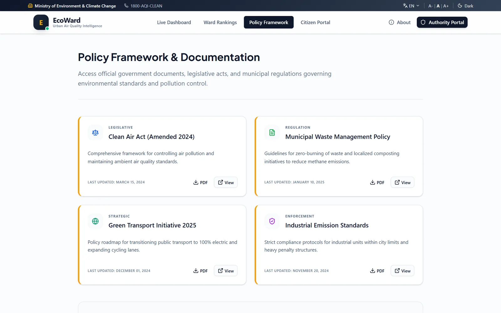
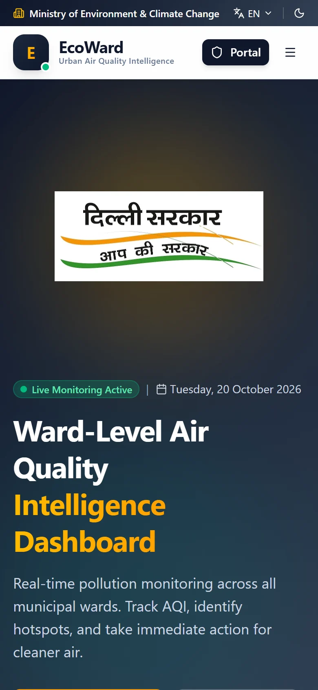

<div align="center">


**Ward-level air quality intelligence for Delhi: see which wards are worst, why, and what the authorities are doing about it.**

[Live dashboard](https://new-delhi-dashboard-eco-ward.vercel.app)



</div>

## What it does

City-wide AQI hides the real picture: one industrial ward can be at 310 while a residential ward next to it is at 62. EcoWard breaks Delhi's air quality down by municipal ward. It is built for two audiences: citizens who want to report pollution, and the authorities who act on those reports.

## Screens

<table>
  <tr>
    <td width="50%"></td>
    <td width="50%"></td>
  </tr>
  <tr>
    <td><b>Ward health.</b> Per-ward AQI, PM2.5 and PM10, a health index, and a community pollution heatmap.</td>
    <td><b>Why it's bad.</b> Pollution source attribution (vehicles, industry, construction dust, waste burning) and a 24-hour AQI trend.</td>
  </tr>
  <tr>
    <td></td>
    <td></td>
  </tr>
  <tr>
    <td><b>Area rankings.</b> Delhi localities ranked by air quality, with the cleanest area highlighted.</td>
    <td><b>Citizen portal.</b> Report a pollution incident with your GPS location and track earlier reports.</td>
  </tr>
  <tr>
    <td></td>
    <td></td>
  </tr>
  <tr>
    <td><b>Government command center.</b> Wards with the most citizen signals, category clustering, the action logbook and impact monitor.</td>
    <td><b>Policy framework.</b> The acts and policies that apply, such as the Clean Air Act and waste management rules.</td>
  </tr>
</table>

<p align="center"></p>

The header has an English/Hindi switch, text size controls and a dark mode.

## Data

The numbers in this build are demo data from `src/lib/data.ts`. No live sensor feed is connected yet.

## Tech stack

Next.js 15 (App Router), React, TypeScript, Tailwind CSS, shadcn/ui, Recharts, Framer Motion. Deployed on Vercel.

## Run locally

```bash
npm install
npm run dev        # http://localhost:3000
```

## Routes

| Route | Page |
|---|---|
| `/` | Live dashboard |
| `/ranking` | Ward and area rankings |
| `/grievance` | Citizen pollution reports |
| `/authority` | Government command center |
| `/policies` | Policy framework |
| `/about` | About |
| `/login` | Authority sign-in |
